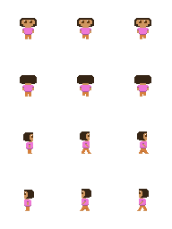
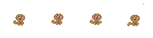
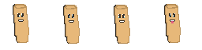

<h1>RPG Write Up</h1>

<h2>The Story</h2>
You play as Dora the explorer in a forest trying to escape from ratGPT. You do this by talking to NPC's, picking up keys, and putting them in key slots.

<h2>The Characters</h2>
 
This is the player  
  
This NPC tells you to go to the Map, and gives you an escape key once you have picked up both  
  
This NPC tells you how to pick up the keys

<h2>The Tinkers</h2>
- Items that can be picked up (keys)  
  
- Key slots to put they keys in  
  
- Changed movement to be better  
  
- "Collision" with invisible NPC's  
  

<h2></h2>
